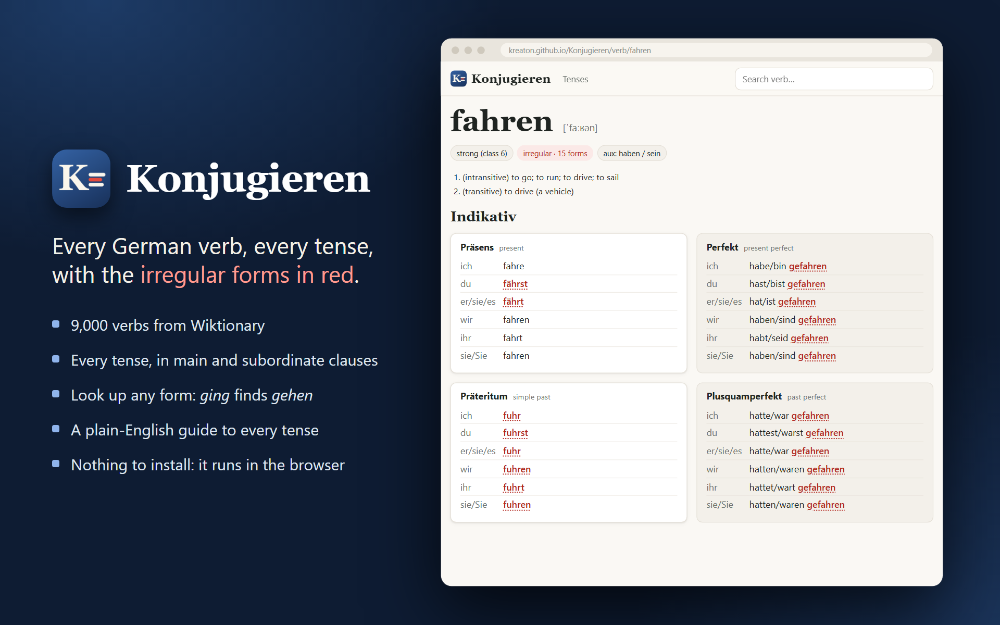

# Konjugieren

[](https://kreaton.github.io/Konjugieren/)
[](LICENSE)
[](#license--authorship)


[](https://github.com/kreaton/Konjugieren/stargazers)

⭐ If Konjugieren helps you with your German, [star it on GitHub](https://github.com/kreaton/Konjugieren). It's free, it's made by one developer, and stars are how other people find it.



**Conjugation tables for 9,000 German verbs, with the irregular forms in red and every tense explained.**

**Open it: <https://kreaton.github.io/Konjugieren/>**

Konjugieren is the German sister of [Coniuga](https://github.com/kreaton/Coniuga), the Italian conjugation app,
and is built the same way.

Type a verb and you get its full table: all moods and tenses, the compound tenses with the right
auxiliary, the infinitives and participles, definitions and pronunciation. Every form that doesn't
follow the weak (regular) pattern is shown in red, so *du fährst, er fährt, fuhr, gefahren* stands out
from *ich fahre, wir fahren*.

- **Search by infinitive or by any form.** Typing *ging*, *bin* or *rief* finds *gehen*, *sein* and
  *rufen* (and *anrufen, abrufen …*), and says which tense and person the form is.
- **Every tense, compound ones included.** Perfekt, Plusquamperfekt, Futur I and II, Konjunktiv I and
  II with the *würde* forms. *Haben* or *sein* is chosen per verb, and verbs that take both show both
  (*habe/bin gefahren*).
- **Main and subordinate clauses.** One switch shows every tense in verb-final order, as after *dass,
  weil, wenn*: *ich rufe an* becomes *dass ich anrufe*, *ich habe angerufen* becomes *dass ich angerufen
  habe*. Separable and reflexive verbs are handled in both orders.
- **Irregular forms in red.** Each verb is compared with the weak model, so you see exactly which
  forms you have to learn by heart: the vowel changes of the strong verbs, the mixed verbs
  (*bringen → brachte*), the modals. The badge counts them.
- **The tenses explained.** The [tense guide](https://kreaton.github.io/Konjugieren/guide) says in plain
  English what each mood and tense is used for, how the regular forms are built (with endings for
  *machen*, *arbeiten* and *fahren*) and gives example sentences. Every table on a verb page links to
  its section.
- **Variants.** Where German has two forms, both are shown (*mach / mache*). Forms Wiktionary marks
  as archaic, regional or colloquial only appear when you tick a checkbox.
- **Nothing to install.** It's a static web app: the whole database is downloaded once (4.5 MB) and
  queried in the browser with SQLite compiled to WebAssembly. It can be installed as an app on
  Windows, Android and iOS.

## The data

The verbs come from [Wiktionary](https://en.wiktionary.org/), as extracted by
[kaikki.org](https://kaikki.org/) (wiktextract) and turned into SQLite by KaikkiVerbs, a separate tool
that builds the same kind of database for Italian, Spanish, Portuguese, French and German. The app
ships that database as it is (`src/Konjugieren/wwwroot/data/verbs.sqlite.gz`, a copy of KaikkiVerbs'
`verbs-de.sqlite.gz`).

What the source has, and what it lacks:

- **Simple tenses only.** Infinitive, zu-infinitive, the two participles, Präsens, Präteritum,
  Konjunktiv I and II × six persons, the imperative, and the auxiliary. The compound tenses are not
  there; the app builds them from *haben/sein/werden* and the participle or infinitive.
- **Both word orders.** For separable and reflexive verbs every finite form is stored twice: *rufe an*
  and, labelled "subordinate clause", *anrufe*.
- **Every form in full.** Regular and irregular forms are stored the same way. The source gives each
  verb a class (weak, strong class 1–7, irregular weak, preterite-present …), but not which forms are
  irregular. Konjugieren works that out itself (below).
- **9,333 full tables and 25 alternative forms**, which link to the main verb.
- **Only a few reflexive entries.** Wiktionary lists most reflexive uses under the plain verb
  (*waschen*, with a sense "*sich waschen*"), so there are only a handful of *sich …* entries.

### What Konjugieren adds for German

KaikkiVerbs stores what Wiktionary has, in a layout shared by all its languages. `VerbDatabase` reads
it and adds the German-specific parts the app needs:

- the subordinate-clause forms as a word order rather than a usage note, and the separable particle,
  read from the main-clause forms (*ruft an* → *an*; *macht wieder gut* → *wieder gut*);
- the Konjunktiv II as main forms: Wiktionary labels it "formal, rare" for most verbs, which only
  means that speech prefers *würde* + infinitive, so the table says that in a footnote instead;
- the compound tenses in both word orders (`ConjugationBuilder`), with the reflexive pronoun in the
  right place (*ich habe mich gesputet*, *dass ich mich gesputet habe*) and the polite *Sie*
  imperative from the Konjunktiv I (*rufen Sie an*);
- the regular/irregular marking, worked out per verb when it is first shown.

### Regular or irregular?

`RegularConjugator` generates the weak paradigm for each verb, including the spelling rules that are
still regular: the extra *e* after *-d/-t* and consonant + *m/n* (*arbeitest, atmet, rechnete*), *du*
+ *-t* after *s, ß, x, z* (*du reist*), and the *-eln/-ern* verbs (*ich sammle, wir sammeln*). The
past participle's *ge-* is accepted with or without, and anywhere in a compound (*mausgerutscht*),
because it follows stress rather than the verb's class. Separable and reflexive verbs are compared in
both word orders. Every primary form from Wiktionary is compared with the generated one; where they
differ, the form is marked irregular.

| Wiktionary class | Verbs | Marked irregular |
|------------------|------:|-----------------:|
| weak | 7,180 | 36 |
| strong (classes 1–7) | 1,778 | 1,775 |
| irregular weak (mixed) | 139 | 99 |
| preterite-present | 65 | 65 |
| irregular | 62 | 62 |
| other and mixed classes | 109 | 86 |

The 36 weak verbs are either real exceptions (*brauchen → bräuchte*, *winken → gewunken*) or tables
that are broken in the source. A weak verb with 25 or more "irregular" forms almost always means the
latter, and the verb page says so.

### The database

The KaikkiVerbs schema:

| Table | Holds |
|-------|-------|
| `verb` | infinitive, conjugation class, reflexive, auxiliary, alternative-form link (`lemma_id`), etymology, Wiktionary URL |
| `form` | one row per form: verb, tense, person, variant, value, note |
| `tense`, `person` | the tenses (German and English names) and persons |
| `definition`, `example`, `pronunciation` | senses with their usage labels, example sentences, IPA |
| `meta` | source, date and licence |

It has 389,360 forms and comes to 16 MB, or 4.5 MB gzipped. The app inflates it into the in-memory
file system of the WebAssembly runtime and opens it read-only with `Microsoft.Data.Sqlite`. There is
no index on the form values: a full scan for the reverse lookup is fast enough.

To update the data, rebuild it with KaikkiVerbs (`download de`, then `build de`) and copy
`data/de/verbs-de.sqlite.gz` over `src/Konjugieren/wwwroot/data/verbs.sqlite.gz`.

## Run

```powershell
dotnet workload install wasm-tools
dotnet run --project src/Konjugieren
```

The app then runs at http://localhost:5039. The `wasm-tools` workload is needed because the native
SQLite library is linked into the WebAssembly runtime (`WasmBuildNative`).

## Icons

The app icon (iOS home screen, Windows/Android install via the web app manifest, and the browser
favicon) is drawn by a script into `src/Konjugieren/wwwroot/icons` and `wwwroot/favicon.ico`:

```powershell
powershell -File tools\make-icons.ps1
```

The README banner (`images/banner.png`) is `tools/banner.html` rendered by headless Edge, using the
app's own stylesheet:

```powershell
powershell -File tools\make-banner.ps1
```

## Version

`Directory.Build.props` sets the version: Major.Minor by hand, and the patch is the GitHub Actions
run number (0 for local builds). The footer shows the version, build time and git commit.

## Deploy

`.github/workflows/deploy.yml` publishes to [GitHub Pages](https://kreaton.github.io/Konjugieren/) on every
push to `main` (or manually from the Actions tab).

The app has real routes (`/verb/machen`, `/guide`), so the `<base href>` can't be relative: the
workflow sets it to `/Konjugieren/` and copies `index.html` to `404.html`, so that deep links and reloads
work on GitHub Pages.

## License & Authorship

The code in this repository is distributed under the terms of the [MIT License](LICENSE).

The verb data (`src/Konjugieren/wwwroot/data/verbs.sqlite.gz`) comes from
[Wiktionary](https://en.wiktionary.org/), via [kaikki.org](https://kaikki.org/), and is licensed under
[CC BY-SA 4.0](https://creativecommons.org/licenses/by-sa/4.0/), not MIT. If you reuse it, credit
Wiktionary and share it under the same licence. The compound tenses and the regular/irregular marking
are derived by Konjugieren.

**AI authorship note:** Most of the source code in this repository was generated with AI coding agents (Claude Code), under my direction and review. Purely AI-generated material may not be eligible for copyright protection in some jurisdictions. To the extent any part of this project is protected by copyright, it is licensed under the MIT License, and the license's warranty and liability disclaimers apply to the project as a whole.

<!-- notices:start -->
### Independent development

Konjugieren is an independent, personal project developed by Per Hejndorf. It is not affiliated with, endorsed by or sponsored by Microsoft, the Wikimedia Foundation or any other rights holder. Product names and logos are trademarks of their respective owners and are used only to identify the services and tools the project works with.

### Third-party notices and asset provenance

[THIRD-PARTY-NOTICES.md](THIRD-PARTY-NOTICES.md) lists every third-party library, data source and online service the project uses, with version, licence, source and whether it was modified. It also records where the icons and images came from and how they are licensed.
<!-- notices:end -->
